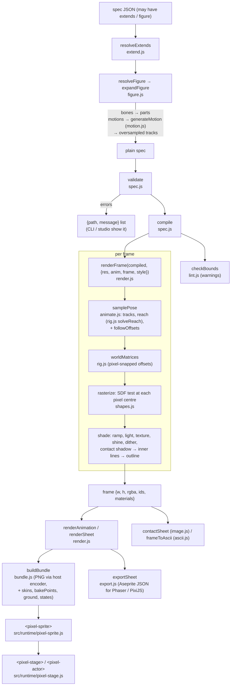

# Pixel Studio architecture

This document explains how the engine works inside, for people who want to change it. It does not
cover why the system is shaped this way (see [DESIGN.md](DESIGN.md)) or the spec format itself (see
[SPEC.md](SPEC.md)). Figures and motion models get a short section here; the full reference is
[figures.md](figures.md). The web runtimes get a short section too; their references are
[runtime.md](runtime.md) (`<pixel-sprite>`) and [stage.md](stage.md) (`<pixel-stage>`).

Every mechanism below cites the file and function that implements it. If the code and this document
disagree, the code is right. Please fix the document in the same change.

## Contents

1. [Pipeline](#1-pipeline)
2. [Module map](#2-module-map)
3. [Spec resolution: extends and figures](#3-spec-resolution-extends-and-figures)
4. [Validation, compilation and lint](#4-validation-compilation-and-lint)
5. [Animation internals](#5-animation-internals)
6. [Rendering internals](#6-rendering-internals)
7. [Output: sheets, bundles, export, runtime](#7-output-sheets-bundles-export-runtime)
8. [Invariants](#8-invariants)
9. [How to extend](#9-how-to-extend)
10. [Testing](#10-testing)

## 1. Pipeline



The same steps as text:

```
spec ──resolveSpec──▶ plain spec ──validate──▶ {errors, warnings}
                                   │ (no errors)
                                   ▼
                                 compile ──▶ compiled {size, materials, parts, animations, style,
                                                       points, ground, skins, states}
                                   │
       for each animation × frame × resolution:
                                   ▼
   resolveStyle(compiled, res, overrides) ──▶ style (lod preset < spec.style < overrides)
   samplePose(compiled, anim, f)           ──▶ Map(partId → {x, y, rot, sx, sy, show})
   worldMatrices(parts, pose, snap)        ──▶ Map(partId → affine matrix), visibility
   raster pass  (one SDF sample per pixel) ──▶ hitPart / hitShape / local point per pixel
   shade pass                              ──▶ rgba + material ids
   inner-line pass, outline pass           ──▶ final frame
                                   ▼
   renderSheet ──▶ buildBundle ──▶ JSON {format, size, ground, animations, points?, skins?, states?,
                                         variants[{res, image, skin?}]} ──▶ <pixel-sprite> ──▶ <pixel-stage>
               └─▶ exportSheet ──▶ sheet + Aseprite JSON (frames, frameTags, slices) ──▶ Phaser / PixiJS
```

Each stage passes plain data to the next. Nothing downstream of `resolveSpec` knows that figures,
motions or variants exist. (Skins are the exception that proves the rule: `compile` turns each skin
into a whole compiled character of its own, so the renderer still sees only plain compiled specs.) By the time `validate` runs, a goose dressed on the `goose` figure with a
`walk` motion is ordinary parts and keyframe arrays.

## 2. Module map

### `src/core/` (the engine; isomorphic, zero dependencies)

| File | Responsibility | Main exports |
|---|---|---|
| `index.js` | Public API barrel. Hosts should import from here. | everything below that is public |
| `extend.js` | Variants: merge a spec onto its `extends` base (points and skins by name), then call `resolveFigure`. | `resolveExtends`, `mergeVariant`, `resolveSpec` |
| `figure.js` | Expand `figure`: bones become parts, motions become tracks (author tracks layered on top), model events become frame numbers, and the figure's foot line (`ground`) and attachment `points` are fitted. `views` add the same character seen from other angles (`idle@front`, `turn@front`, ...). | `resolveFigure`, `expandFigure` |
| `motion.js` | Motion models (`gait`, `idle`, `pose`, `hop`, `jump`, `climb`, `fall`, `sit`) that generate per-sample track arrays with planted feet, plus `speed`/`speedY`/`wall` and timed events. | `generateMotion`, `MOTION_MODELS`, `LEGGED_MODELS`, `OVERSAMPLE` |
| `spec.js` | Structural validation (JSON paths, did-you-mean; `validateStates` for the state machine) and compilation into the renderer's structure, skins included. | `validate`, `compile`, `TRACK_PROPS`, `skinSpec` (not re-exported from `index.js`) |
| `shapes.js` | Signed distance functions and `compileShape` (sdf, thickness `R`, bbox). | `SHAPE_TYPES`, `compileShape`, `sdEllipse`, `sdRoundRect`, `sdCapsule`, `sdPolygon` |
| `animate.js` | Track sampling, pose composition, follow-through springs. | `sampleValue`, `frameTime`, `samplePose`, `samplePoseAt`, `followOffsets` |
| `rig.js` | 2D affine maths, world matrices, CCD reach solver, bounds sampling. | `worldMatrices`, `solveReach`, `ccd`, `overflowForPose`, `invert`, `apply`, `angleOf`, `localMatrix`, `mul` |
| `lint.js` | Checks that need poses: parts leaving the canvas, reach targets missed. | `checkBounds` |
| `render.js` | Style resolution, rasterizer, pixel-art shader, animation and sheet rendering, per-animation playback metadata. | `renderFrame`, `renderAnimation`, `renderSheet`, `animationMeta`, `resolveStyle`, `lodForRes`, `DETAIL_PRESETS`, `DETAIL_NAMES`, `MAX_RES` |
| `color.js` | Hex parsing, HSV/HSL conversion, hue-shifted ramps, `darken`. | `buildRamp`, `baseIndex`, `parseHex`, `toHex`, `darken` |
| `textures.js` | Procedural textures sampled in part-local pixel space. | `TEXTURES`, `sampleTexture`, `hash2` |
| `image.js` | RGBA image helpers and the contact sheet used by `preview`. | `contactSheet`, `createImage`, `blit`, `checker` (not re-exported from `index.js`) |
| `ascii.js` | A frame as text (one letter per material, `#` outline, `.` empty). | `frameToAscii` |
| `bundle.js` | Render one sheet per resolution (and per skin, stored as a colour swap + overlay of the default sheet when smaller) and package them for the runtime with `size`, `ground`, baked points and `states`; optionally without some views. | `buildBundle`, `bakePoints`, `skinDelta`, `keepViews`, `BUNDLE_FORMAT` (`'pixel-sprite/1'`) |
| `export.js` | One sheet plus Aseprite "hash" JSON for game engines (Phaser, PixiJS): frames, tags, slices for points, Pixel Studio extras. | `exportSheet` |
| `mix.js` | Transition clips (`mixes`): a few frames that interpolate the pose from the end of one animation to the start of another, added to the compiled animations as `"from>to"`. | `buildMixes` |
| `plugins.js` | Extension points: register shapes, textures and motion models; they join the built-in tables so validation and `pixel brief` treat them like built-ins. | `registerShape`, `registerTexture`, `registerMotion`, `registeredPlugins`, `usePlugin` |
| `png.js` | PNG bytes for any host (zlib injected): indexed (PLTE + tRNS, 1–8 bits) up to 256 colours, else RGBA8 with per-row filters. | `pngBytes`, `paletteOf` |

### Everything else

| File | Responsibility | Main exports / entry |
|---|---|---|
| `src/node/png.js` | `pngBytes` with `node:zlib` deflate level 9. Node-only. | `encodePNG(w, h, rgba) → Buffer` |
| `src/runtime/pixel-sprite.js` | `<pixel-sprite>` web component: loads a bundle, picks a variant (and skin), plays frames from the sheet, fires baked events, runs the bundle's state machine, and exports the shared frame clock. Does not import the engine. | `PixelSprite`, `clock`, `pickVariant`, `deviceScale`, `checkBundle`, `StateMachine`, `parseCondition`, `BurstDetector`, `BUNDLE_FORMAT` |
| `src/runtime/pixel-stage.js` | `<pixel-stage>` and `<pixel-actor>`: characters that roam a page, standing on, jumping between, climbing and hiding behind opted-in elements. Imports only `clock` from `pixel-sprite.js`. | `PixelStage`, `PixelActor`, `World`, `checkScene`, `runScene`, `jumpArc`, `cells` |
| `bin/pixel.mjs` | CLI: `validate`, `preview`, `ascii`, `render`, `export`, `bundle`, `resolve`, `where`, `figures`, `brief`. Loads files, calls `resolveSpec`, then the core. | `pixel` bin (see `package.json`) |
| `scripts/build-demo.mjs` | Builds `demo/assets/*.bundle.json` from `examples/*.json` at 16/32/64 px, writes a 64 px poster of each (`demo/assets/*.poster.png`) and a 32 px `exportSheet` sheet for `goose-root`, copies both runtimes (`pixel-sprite.js`, `pixel-stage.js`), and with `--previews` writes `previews/*.png`. | `npm run build:demo`, `npm run previews` |
| `demo/index.html`, `demo/flock.html`, `demo/stage.html`, `demo/runner.html`, `demo/pp.html` | Demo pages: sprites on a site (including a state machine and skins section), the goose flock, `<pixel-stage>` characters roaming a page, a tiny runner game played by the fox, and a studio website sketch with a goose that follows the scroll. | pages |
| `scripts/serve.mjs` | Zero-dependency static server for the repo root (studio and demo), port `PORT` or 5173. | `npm run studio` |
| `studio/app.js` | Studio UI: editor → `resolveSpec` → `validate` → `compile` → `checkBounds` → render (current view, LOD strip at 16/24/32/48/64 px, sheet), rig overlay, export with a canvas PNG encoder. | browser module |
| `studio/agent.js` | Agent tab: calls the Anthropic SDK from the browser (loaded lazily from esm.sh), validation-repair loop, contact-sheet critique. | `initAgent`, `extractSpec` |
| `studio/goose.html` | Goose workbench: resolves `{extends: <goose>, …features}` in the page, renders frames on demand with `renderFrame`, hides parts/shapes on a copy of the compiled spec (bones stay), exports a variant spec and checks it builds. Features live in `studio/goose-features.json`. | page |
| `studio/figures.html` | Figure viewer: inline module that draws each figure's skeleton with `samplePoseAt` + `followOffsets` (smooth time, trails, onion skin). | page |
| `studio/index.html`, `studio/studio.css` | Studio markup and styles. | — |

## 3. Spec resolution: extends and figures

`resolveSpec(spec, {loadRef, loadFigure, warn})` in `extend.js` is the single entry point for
turning an authored file into a plain spec. It runs two steps in a fixed order:

1. **`resolveExtends`** follows the `extends` chain recursively, up to depth 8. It raises
   `"chain is too deep (cycle?)"` after that. Each level calls `mergeVariant(resolvedBase, variant)`.
   Merge rules:
   - materials merge per field, and `null` removes;
   - parts are patched by `id`: `remove: true` removes the part and its descendants, `addShapes`
     appends, other fields replace, and unknown ids are appended;
   - `materialMap` re-points shape materials, including the variant's own shapes;
   - materials that the base used but the variant no longer uses are dropped;
   - animations merge per track property, and `null` removes;
   - tracks and reach constraints that refer to removed parts are dropped;
   - `points` and `skins` merge by name, and `null` removes one;
   - `style` merges.

   Errors carry `e.errors = [{path:'$', message}]`, the same shape as validation errors.
2. **`resolveFigure`** (`figure.js`) loads the figure by name through `loadFigure` and calls
   `expandFigure`. Because extends runs first, a variant of a figure-based spec (for example
   `examples/goose-root.json` extends `goose-base.json`, which uses `"figure": "goose"`) patches the
   unexpanded dressing, and the figure is expanded once at the end.

Loaders are injected by the host, which keeps the core free of I/O. The CLI resolves `extends` paths
relative to the referring file (`bin/pixel.mjs`, `loadSpec`). The studio and `build-demo.mjs`
resolve them inside `examples/`. All three read figures from `figures/<name>.json`.

### Figures and motion (brief)

`expandFigure(spec, figure, fit, warn)` in `figure.js`:

- **Bones become parts.** Each bone `{id, parent, from, to, z, side, follow}` becomes a part with
  `pivot = from`, `tip = to`, `z = bone.z ?? index` and `shapes: []`. `side: "far"` adds
  `shade: -0.3`. Bones are first fitted by `fit.scale`, `fit.offset` and `fit.origin` (default: bottom
  centre of the canvas), and patched by `fit.bones`.
- **Dressing.** A spec part whose `id` matches a bone is merged into that bone part. A part with
  `bone: "x"` becomes a child of bone `x`, with `pivot = from` and `z = bone.z + 0.5`. Any other
  part is appended as is. A spec with no `parts` gets a stick figure: capsules of `r` 1.4 with
  material `bone`, joint circles of `r` 2.4 (1.8 at leaf tips) with material `joint`, and
  `style.outline: 'dark'`.
- **Motions become tracks.** For each animation with `motion`, the preset parameters
  (`figure.motions[name]`) are merged with the animation's own fields. `generateMotion` (`motion.js`)
  is then called with the expanded parts, `figure.rig` and the author's `tracks` as `input`. It
  simulates the motion twice (the first pass warm-starts the IK so the loop closes) and records
  `M` samples per track. `M = frames × OVERSAMPLE` when looping and `(frames − 1) × OVERSAMPLE + 1`
  for one-shots, with `OVERSAMPLE = 4`. Values are rounded to 0.01. A track whose samples are all
  equal collapses to a number. Foot misses over 0.3 units are reported through `warn`.
- **Layering.** `layerTracks` resamples the author's tracks at the same `M` points and combines
  them with the generated ones: `x`, `y` and `rot` add, `sx` and `sy` multiply, `show` replaces.
  Root `x`/`y`/`rot` tracks are not layered a second time, because `generateMotion` already applied
  them before solving the legs (so feet stay planted under author body motion).
- Gait and hop animations get `speed`, in units per second. The page moves the sprite at this speed
  so planted feet do not slide. Climb animations get `speedY` (units per second upward) and `wall`
  (the x of the wall the feet hold).
- **Events.** `generateMotion` reports events in normalized time `u`: `footstep` per leg
  (`data: {leg}`) for `gait` and `climb`, `takeoff`/`land` for `hop`, `launch`/`land` for `jump`.
  `expandFigure` turns `u` into the first frame at or after it (`ceil(u·frames) mod frames` looping,
  `ceil(u·(frames − 1))` one-shot), appends the author's `events`, and sorts by frame.
  `"events": false` drops the model's events. `holds` is copied through.
- **Ground and points.** Unless the spec sets `ground`, `expandFigure` takes the figure's `ground`
  (fitted), else `groundOf`: the lowest toe of the rig's legs, else the shadow bone's line, else the
  root bone. Figure `points` on existing bones are fitted and merged under the spec's own `points`.
- **Rig roles.** `root` is always required; the models in `LEGGED_MODELS` (`gait`, `pose`, `jump`,
  `climb`, `sit`) also need `legs`. Optional roles: `neck`, `head`, `arms`, `tail`, `wings` (flapped
  in `fall`, `climb` and `jump`), `shadow`, `view`.

Generated tracks are keyframe arrays with `M` entries. With linear interpolation (section 5), frame
`f` lands exactly on sample `f × OVERSAMPLE`. The extra samples only matter where time is sampled
between frames: the follow-through simulation and the studio's smooth figure view. After expansion
the output is a plain spec. `validate` rejects any leftover `figure` or `motion` key with a message
that says to resolve it first.

## 4. Validation, compilation and lint

### `validate(spec)` (`spec.js`)

`validate` returns `{errors: [{path, message}], warnings: [{path, message}]}`. Paths are JSONPath-like
strings built while walking the spec, for example `$.parts[3].shapes[0].material` or
`$.animations.walk.tracks.legL.rot`. Errors block compilation. Warnings never do.

- **Did-you-mean.** `didYouMean(word, options)` returns the option with the smallest Levenshtein
  distance, provided that distance is below 3. It is appended to errors for unknown shape types,
  textures, materials, parents, track parts, track properties and reach chain ids.
- **Unknown keys** produce warnings, not errors, through `unknownKeys(obj, kind, ...)` against the
  `KNOWN` table. Every object kind (top level, material, part, shape, animation, follow, reach,
  style, wave, keys) has an entry there.
- **Structural checks:**
  - hex colours, and `shine` in 0..1;
  - unique part ids, unknown parents, and parent cycles;
  - per-type required shape fields (`SHAPE_REQUIRED`), and polygons with at least 3 points;
  - `op` must be `add` or `cut`; cuts need no material;
  - `profile` in `dome|flat|none`;
  - `frames` is an integer 1..64, and `fps` is in 1..60;
  - track values must be a number, a non-empty number array, `{keys}` or `{wave}` (`isTrackValue`);
  - `style.outline` in `none|dark|selective`.
- **Bones without shapes.** A part with a `tip` may have `shapes: []`.
- **Off-canvas warning.** `compileShape` is run on each shape and its bbox is checked against `size`,
  before part transforms. This only happens while no errors have been found yet.
- **Unused material warnings.**
- **Reach** (`validateReach`): the chain ids must exist, every chain id must be `end` or one of its
  ancestors, `tip` must be a point, `target` must be a pair of track values, `aim` needs at least one
  chain part besides `end`, and `limits` must be `{id: [min, max]}` for chain members only.
- **Animation extras:** `speedY` and `wall` are numbers; `events` are `{frame, name, data?}` with an
  integer `frame` inside the animation; `holds` keys are frame indices and values are in (0, 16].
- **Points:** each names an existing part, and `at` is `[x, y]`, `"pivot"`, or `"tip"` (bones only).
- **Ground:** a number in `0..size[1]`.
- **Skins:** each is an object with only `parts`, `materials`, `materialMap` and `style` (`SKIN_KEYS`).
  When the spec has no other errors yet, `skinSpec(spec, patch)` (the spec without `skins` and
  `states`, merged with the patch by `mergeVariant`) is validated, and its errors are re-reported
  under `$.skins.<name>`.
- **States** (`validateStates`): `nodes` is non-empty and every node's `anim` exists; `then` is a node
  or `"previous"`; `random` fidgets name existing animations; `initial` and transition `from`/`to` are
  nodes (`from` may be `"*"`); `when` conditions parse (`name`, `!name`, `name op literal`, joined by
  `&&` or `and`) and name declared inputs; inputs start as a number, boolean, word or `"trigger"`;
  a node's `rate` is a speed in (0, 4] or the name of an input; a transition's `at` is a string
  (`"now"`, `"end"`, `"sync"` or an event name); interactions use
  `on: click|enter|leave|burst|calm` and `fire`/`set` declared inputs. Unknown `states` keys warn.
- **Mixes:** `mixes` is an object; each key is `"from>to"` naming two different existing animations;
  each value is an object with `frames` a whole number 1..8, `ease` `linear` or `smooth`, and `fps`
  in 1..60.

`ease` names, wave `shape` names, and the types of `style` values and of `material.tones` /
`textureScale` / `textureStrength` are validated too. Not validated: event `data` (any JSON value),
the timing fields of `states` random fidgets (`every`, `weight`), and a non-array `states.interactions`
(ignored).

### `compile(spec)` (`spec.js`)

`compile` calls `validate` and throws `Error('invalid spec: ...')` with `.errors` if there are any.
Otherwise it normalizes the spec:

- **Materials** become `{color, texture, textureScale: 1, textureStrength: 0.35, shine: 0, flat, outline: true, tones}`.
  A bare hex string `"#rrggbb"` is accepted as a material.
- **Parts** become `{id, index, parent, pivot (default: canvas centre), z (default: array index), tip, follow, base: {x, y, rot, sx, sy, show}, shade, shapes}`.
- **Follow.** `compileFollow` turns `follow: n` into `{freq: 3, damping: 0.3, amount: n, max: 40}`.
- **Shapes** are `compileShape(s)` (`sdf`, `R`, `bbox`) plus `op`, `material`, `minDetail` (1),
  `maxDetail` (3), `profile` (`dome`) and `shade` (0).
- **Animations** become `{name, frames, fps: 8, loop: true, tracks, reach: [], speed: 0, speedY: 0, wall: null, events: [], holds: null}`.
  Events are sorted by frame; `holds` keys become numbers.
- **No animations.** A spec without animations gets `still` (1 frame, 1 fps).
- **Points** become `{part, at}` with `"tip"` and `"pivot"` replaced by the part's rest-pose point.
- **`ground`** and **`states`** are copied (`null` when absent).
- **Skins.** Each skin is compiled recursively, `compile(skinSpec(spec, patch))`, into a full
  compiled character with the same animations; `compiled.skins` maps names to them (`null` without
  skins).

### `checkBounds(compiled, {margin = 0.5})` (`lint.js`)

`checkBounds` samples every frame of every animation with `samplePose`, so tracks, reach and
follow-through are all included. For each frame:

- **Overflow.** `overflowForPose` (`rig.js`) transforms each visible part's edge samples into world
  units and records how far they go past each canvas edge. `samplesFor` produces the edge samples:
  bbox points on a 0.75-unit grid with `-1.5 < sdf ≤ 0`, cached per compiled shape in a `WeakMap`.
  Overflows larger than `margin` are aggregated per part and edge. The warning lists the frame
  ranges, for example `"head" goes 8.2 units past the right edge in frames 2–7`.
- **Reach.** Any reach constraint whose `pose.reachMiss` is above 1 unit gets a warning that names
  the chain and suggests what to relax.

Bounds warnings use the same `{path, message}` shape as validation warnings, plus `anim`, `part`,
`edge`, `frames` and `amount`. The CLI (`compileOrExit`, `validate`) and the studio (`rebuild`) print
them next to validation output.

## 5. Animation internals

### Track values (`animate.js`, `sampleValue`)

`sampleValue(v, t, loop, isStep, defaultOffset)` takes normalized time `t ∈ [0, 1)` (or `[0, 1]` for
one-shots):

| Form | Evaluation |
|---|---|
| `3` | constant |
| `[a, b, c, ...]` | `interp(keys, t, loop, 'linear')` |
| `{keys, ease}` | `interp` with `linear`, `smooth` (smoothstep `f²(3−2f)`) or `step`. Any other string behaves as linear. |
| `{wave, phase, cycles, offset, shape}` | `offset + wave × w(x)` with `x = (t × cycles + phase) % 1`. `w` is `sin` (default), `tri` (same phase as sin), `square` (+1 for the first half), or `bounce = −|sin(2πx)|` (two bumps per cycle, 0 at contact, negative = up). |

`interp` spreads keys evenly over the cycle:

- **Looping:** the span is `n`, so the last key interpolates back to the first. `[0, 10]` reaches 10
  at `t = 0.5` and is back to 5 at `t = 0.75`.
- **One-shot:** the span is `n − 1`, so the last key is reached at `t = 1` and held.

`show` is always stepped. Arrays and keys use `step`, and a wave becomes `1` when its value is ≥ 0.
`sx`/`sy` waves use `defaultOffset = 1`, so `{"wave": 0.06}` oscillates over 0.94..1.06. Numbers and
arrays on `sx`/`sy` are absolute factors.

### Time mapping (`frameTime`)

```
loop:     t = f / frames         (frame 0 and the virtual frame `frames` coincide → seamless)
one-shot: t = f / (frames − 1)   (first and last frames hit t = 0 and t = 1 exactly)
frames ≤ 1: t = 0
```

`renderFrame` wraps the frame index with `frame % frames`. `loop` defaults to `true` in `compile`.
The runtime decides what happens after the last frame (section 7).

### Pose composition (`samplePoseAt`)

For each part, the base transform from `compile` is combined with the sampled track values. A missing
track leaves the base unchanged:

```
x    = base.x   + track.x        rot = base.rot + track.rot
y    = base.y   + track.y        sx  = base.sx  × track.sx      sy = base.sy × track.sy
show = (track.show ?? base.show) ≥ 0.5
```

The local matrix is built by `localMatrix(pivot, t)` in `rig.js`:

```
local = T(pivot + (x, y)) · R(rot) · S(sx, sy) · T(−pivot)
world = world(parent) · local                (worldMatrices, parents resolved recursively)
visible = show && visible(parent)
```

Pivots and offsets are in rest-pose canvas units. Rotation is in degrees, clockwise on screen
(y points down). The pivot is both the rotation origin and the scale origin. Matrices are
`[a, b, c, d, e, f]` with `x' = a·x + c·y + e` and `y' = b·x + d·y + f`. `invert` clamps the
determinant to `1e-9`, so a zero scale does not produce NaNs.

### Reach constraints: CCD IK (`rig.js`)

After the tracks are applied, `samplePoseAt` solves each `anim.reach[i]` in order. The constraint's
target and `aim` are themselves track values, sampled at `t`.

- **`solveReach(parts, pose, r, target, aim)`** runs `ccd` starting from the current (track) rotations.
  If the tip still misses by more than 0.05 units, it restarts from four perturbed seeds
  (`chain[0]`/`chain[1]` rotated by ±60° or ±120°) and keeps the best result. CCD can settle in a
  local minimum, for example a joint bent the wrong way, and the restarts get it out.
  It returns the remaining distance, which is stored in `pose.reachMiss[i]`.
- **`ccd(parts, pose, r, target, aim, iters = 32)`** runs up to 32 passes and stops early under
  0.05 units. Each pass visits the joints from the end of the chain back to the root. For each
  joint it:
  1. recomputes world matrices;
  2. if `aim` is set, sets the end part's local rotation so its world angle equals `aim`;
  3. rotates the joint by the wrapped angle between "pivot → tip" and "pivot → target".

  With `aim`, the end part is not one of the solved joints. `limits` clamp the local `rot` to
  `[min, max]` as absolute values, which include the base rotation.

`ccd` is also used by `motion.js` for necks, heads and legs that are not two-bone. Two-bone legs use
the exact law-of-cosines solver `twoBone`. Front-view legs use `frontLeg`, which foreshortens with
`sy`.

Cost: each CCD step recomputes every part's world matrix twice, and reach runs inside
`samplePoseAt`, which the follow-through simulation calls once per substep.

### Follow-through (`animate.js`, `followOffsets`)

A part with `follow` is a damped angular spring that hangs from its pivot. `samplePose` adds the
spring angle to the part's `rot` after tracks and reach:

```js
pose.get(id).rot += followOffsets(compiled, anim).get(id)[f % frames]
```

`samplePoseAt` alone, as the studio figure viewer uses it, has no follow-through.

`followOffsets(compiled, anim)` simulates once per animation and caches the result in a
`WeakMap` keyed by the compiled animation object:

- **Spring.** `k = (2π·freq)²` and `c = 2·damping·2π·freq`, so `damping` is the damping ratio
  (1 = critically damped).
- **Driving forces.** Each substep poses the rig at that time, with the current spring angles of
  all followers included, so chains of followers interact. It then computes world matrices and
  takes, for each follower:
  - the **linear acceleration of its pivot** `a`, by second finite differences over the last three
    substeps. This becomes a torque around the pivot using the lever arm `r` to the part's centre
    of mass: `(r × −a) / max(4, |r|²)`, converted to degrees. `centerOf` computes the centre of mass
    as the area-weighted centre of the shape bboxes, or the bone midpoint, or the pivot.
  - the **angular acceleration of its parent** `α`, which the part resists (`−α`).

  The sum is multiplied by `amount`. The spring is integrated with semi-implicit Euler, and the
  angle is clamped to `±max`, with the velocity toward the limit zeroed.
- **Substeps.** There are `SUBSTEPS = 8` per frame. `dt = 1 / (8 · fps)`. Generated motions have
  4 samples per frame, which the 8 substeps interpolate linearly.
- **Warm-up.** Looping animations run 4 passes over the cycle and record the last, so the spring
  has settled into its periodic state and the loop is seamless. One-shots run one pass from rest.
- **Recording.** Every 8th substep the angle is recorded per frame, rounded to 0.01°.
- No followers or fewer than 2 frames gives `null` (cached too).

## 6. Rendering internals

All of this is in `render.js` unless noted otherwise.

### Style resolution (`resolveStyle`)

The style is built from these layers, with later layers winning:

```
defaults { light: −45, elevation: 50, outlineColor: '#1b1424', snap: true, hueShift: 1,
           ambient: 0.15, curvature: 0.8, flip: false }
  < DETAIL_PRESETS[lod]
  < spec.style        (null / undefined / '' values ignored)
  < overrides         (CLI flags, studio knobs; same filtering)
lod = overrides.lod || lodForRes(res)
```

`resolveStyle` throws a readable error for a `lod` other than 1, 2 or 3 and for overrides that break
the `style` rules (for example `tones` outside 2..6). `renderAnimation` refuses a `res` outside
1..`MAX_RES` (512).

### Detail tiers

`lodForRes(res)` returns 1 for `res ≤ 20`, 2 for `res ≤ 40`, and 3 otherwise.
`DETAIL_NAMES = {1: 'icon', 2: 'sprite', 3: 'portrait'}`.

| Key | lod 1 | lod 2 | lod 3 |
|---|---|---|---|
| `tones` | 2 | 3 | 5 |
| `texture` | 0 | 0.6 | 1 |
| `dither` | false | false | true |
| `outline` | `dark` | `selective` | `selective` |
| `innerLines` | false | false | true |
| `contactShadow` | false | true | true |
| `ambientBoost` | 0.25 | 0 | 0 |

A shape is drawn only when `minDetail ≤ lod ≤ maxDetail` (defaults 1 and 3). Parts whose shapes are
all gated out, and bones with no shapes, are skipped entirely.

### Coordinate system and pixel grid

- **Size.** The canvas is `size` units (default `[100, 100]`). For a requested `res`, the frame is
  `H = round(res)` pixels tall and `W = round(res × width / height)` wide, with
  `scale = H / height` pixels per unit. `res` is the frame height.
- **Sampling.** Pixel `(px, py)` samples the world point `((px + 0.5) / scale, (py + 0.5) / scale)`,
  its centre. There is **no supersampling or anti-aliasing**: each pixel takes one binary sample.
  `flip` mirrors the sampling (`px → W − 1 − px`) and negates the x gradient, so the light stays on
  the same screen side.
- **Pixel snapping.** When `st.snap` is on, `worldMatrices` gets an `adjust` hook that runs
  `snapUnits` on each part's `x` and `y` offset before building its matrix. An offset under
  0.35 px becomes 0. Anything larger rounds to whole pixels, with a minimum of 1 px. Rotation and
  scale are not snapped, and the effect accumulates through the hierarchy, because each part's
  local offset is snapped on its own.

### Rasterization: SDF per pixel

`compileShape` (`shapes.js`) returns, for each shape:

- `sdf(x, y)`: signed distance in part-local units, negative inside. `rect` is a rounded box
  (`r`, `rot`), `ellipse`/`circle` an ellipse (with `rot`), `capsule` a segment with radii `r` → `r2`,
  and `polygon` an even-odd polygon distance, minus `r` when rounding is set.
- `R`: the thickness, the largest inner distance. For an ellipse that is `min(rx, ry)`, for a rect
  `min(w, h)/2`, for a capsule `max(r1, r2)`. For a polygon it is estimated on a 13×13 grid over the
  bbox. The minimum is 0.01.
- `bbox` in local units.

For each pixel, `renderFrame` walks the visible parts in draw order, sorted by `z` then by array
index. It maps the pixel centre into each part's local space with the inverse world matrix. Then:

1. A shape is skipped early when the local point is outside its bbox padded by `R + 0.75/scale`.
2. **Thin-feature preservation.** A shape thinner than a pixel is inflated just enough to claim the
   nearest pixel centre. The hit threshold is `thr = reach − R` when `R < reach`, otherwise 0.
   `reach` is half a pixel (`0.5/scale`) for elongated shapes, so lines stay 1 px wide. For "dots",
   whose bbox is under 3 px in both directions, `reach` is `0.75/scale`, a little over the
   half-diagonal.
3. Inside a part, shapes are tested in array order. An `add` shape with `sdf ≤ thr` becomes the hit.
   A `cut` shape clears the part's hit so far. Later shapes override earlier ones, and a cut only
   erases shapes of its own part that come before it.
4. Across parts, a later (front) part that hits overwrites earlier ones, like a painter's algorithm.
   The pixel records the part, the winning shape, and the local point.

**Material unions.** Before rasterizing, every part groups its non-cut shapes by material into a
`surface`. Its `sdf` is the minimum of the member SDFs and its `R` is the largest member `R`.
Lighting uses the surface, not the individual shape, so overlapping shapes of one material read as
one lit volume without seams. The hit test itself still uses individual shapes.

### Shading model

For a hit pixel with material `mat`, the shader does the following:

1. **Ramp.** `ramp = buildRamp(mat.color, tones = mat.tones ?? st.tones, {hueShift})`, memoized in
   the module-level `rampCache`. The base colour sits at `bi = baseIndex(tones)`, which is 1 for 2 or
   3 tones, 2 for 4 or 5, and 3 for 6.
2. **`flat` materials** skip everything below and use the base tone. This is for eyes and emissive
   details.
3. **Normal.**
   - `(gx, gy)`: the normalized gradient of the surface SDF, by central differences in world space
     with `eps = 0.35 px`.
   - `u`: depth inside the surface, `clamp(−sdf / R, 0, 1)`. It is 0 at the edge and 1 at the
     thickest point.
   - `rho`: tilt toward the edge, chosen by the shape's `profile`:
     - `dome`: `1 − u`;
     - `flat`: tilted only in the outer 30% (`(1 − u/0.3) × 0.6`);
     - `none`: 0.
   - Then `rho = min(rho × curvature, 0.85)` and `n = (gx·rho, gy·rho, √(1 − rho²))`.
4. **Light.** `L = (sin az·cos el, −cos az·cos el, sin el)`, where `az = light` (0 = from the top,
   negative = from the left) and `el = elevation`. The diffuse term is `diff = max(0, n·L)`. It is
   remapped around the flat-facing value `flatB = L.z`:
   `v = (diff − flatB)/(1 − flatB)` above it and `(diff − flatB)/flatB` below it, so `v ∈ [−1, 1]`
   and a surface facing the viewer gets `v = 0`.
5. **Offsets.** `v += ambient + ambientBoost + part.shade + shape.shade`.
6. **Contact shadow** (when `contactShadow` is on). The pixel one step toward the light is checked:
   `(sign(round(L.x·1.4)), sign(round(L.y·1.4)))`, which is up-left for the default light. If a part
   with strictly higher `z` covers that pixel, and its material is neither `flat` nor
   `outline: false`, then `v −= 0.7`. Eyes and glints do not cast shadows.
7. **Tone index.** `f = bi + v·bi` for `v < 0`, otherwise `bi + v·(tones − 1 − bi)`. `v = −1` maps
   to the darkest tone and `v = +1` to the lightest.
8. **Texture** (when `mat.texture` and `st.texture > 0`).
   `f += sampleTexture(name, floor(localX·scale), floor(localY·scale), textureScale) × textureStrength × st.texture × 1.3`.
   The coordinates are **part-local pixels at the current resolution**, so the texture moves with
   the limb and its feature size is in pixels.
9. **Shine** (when `mat.shine > 0`). Blinn-Phong with half vector `normalize(L + (0, 0, 1))` and
   exponent 40. When `spec × (0.5 + shine) > 0.55`, the pixel takes the top tone.
10. **Dither.** When `dither` is on and the fractional part of `f` is in (0.3, 0.7), a 4×4 Bayer
    threshold, indexed by the part-local pixel coordinate (so the pattern also sticks to the part),
    picks floor or ceil. Otherwise `f` is rounded. The result is clamped to `[0, tones − 1]`.

`ids[i]` stores the material index. It is −1 for empty pixels and −2 for outline pixels.
`frameToAscii` and the tests use it.

### Hue-shifted ramps (`color.js`, `buildRamp`)

Ramps are built in HSV around the base colour:

| | Hue | Saturation | Value |
|---|---|---|---|
| Shadows, `t = (bi − i)/bi` | drifts toward 250° (blue-violet) by `0.2·t·hueShift` of the arc, capped at 60° of arc (≤ 12° at `hueShift: 1`) | `+0.14·t·(1 − s)` | `×(1 − 0.42·t)` |
| Highlights, `t = (i − bi)/(n − 1 − bi)` | drifts toward 55° (yellow) by `0.14·t·hueShift`, capped at 50° of arc | `×(1 − 0.35·t)` | `+(1 − v)·0.65·t` |

**Greys** (`s < 0.08`) are handled differently. Their shadows take hue 250 with saturation capped at
0.18, and their highlights keep their hue.

`darken(rgb, amount)` uses the same cool drift. It adds 0.1 saturation and scales the value by
`1 − amount`. An invalid hex renders magenta (`[255, 0, 255]`).

### Textures (`textures.js`)

`sampleTexture(name, x, y, s)` takes integer local pixel coordinates and a scale
`s = max(1, round(textureScale))`, and returns a brightness offset of roughly ±1. The textures are:

- `noise`: hash per cell;
- `fur`: vertical streaks per column plus a variation along `y` every `3s`;
- `scales`: offset rows of cells `3s + 1` wide;
- `stripes`: horizontal bands every `2s`;
- `checker`;
- `cloth`: diagonal threads;
- `bricks`: `6s × 3s` with mortar lines;
- `spots`: one jittered spot per `6s` cell;
- `metal`: horizontal brushed bands.

Randomness comes from `hash2`, an integer hash, so it is deterministic.

### Inner lines and outline

Both passes run after shading.

- **Inner lines** (when `innerLines` is on). A pixel gets one when a 4-neighbour belongs to a
  different part with strictly higher `z`, and both materials are non-`flat` with `outline` not
  `false`. The pixel is repainted with `darken(ramp[0], 0.15)` of its own material, so the back part
  gets the line.
- **Outline** (unless `outline: 'none'`). Each **empty** pixel that has a 4-neighbour covered by a
  material with `outline` not `false` becomes an outline pixel. The neighbours are checked in the
  order up, left, right, down, and the first match is the source. Outline pixels have `ids = −2`.
  - `dark`: uses `style.outlineColor`.
  - `selective`: uses `darken(sourceRamp[0], 0.45)`, tinted by the neighbouring material.

  The outline sits outside the silhouette, so it grows the sprite by 1 px. That is why SPEC.md asks
  for margin around the character.

## 7. Output: sheets, bundles, export, runtime

- **`renderAnimation(compiled, name, res, overrides)`** resolves the style once and renders every
  frame.
- **`renderSheet(compiled, res, overrides, names)`** puts one row per animation and one column per
  frame. Width is the maximum frame count, and unused cells stay transparent. It returns
  `meta = {res, lod, frameW, frameH, animations: {name: {row, ...animationMeta(anim)}}}`.
- **`animationMeta(anim)`** (`render.js`) is the playback description shared by sheets, bundles and
  the CLI's `render` JSON: `frames`, `fps`, `loop`, plus `speed`, `speedY`, `wall`, `mix`
  (`{from, to}`, on transition clips) and `events` when set, and `durations` (ms per frame, `1000/fps × hold`) only when the animation has `holds`.
- **`buildBundle(compiled, {resolutions = [16, 32, 64], overrides, encode, views, deltas = true})`**
  (`bundle.js`) first drops the views not listed in `views` (**`keepViews`**: animations named
  `x@view`), then sorts the resolutions ascending and renders a sheet per resolution. It encodes each
  sheet with the host-supplied `encode(w, h, rgba)`: `encodePNG` → data URL in Node, `pngBytes` with
  `CompressionStream` in the studio. Each skin in `compiled.skins` gets the same resolutions again,
  appended as variants tagged `skin`. **`skinDelta(base, skin)`** tries to express a skin sheet as
  `recolor` (each default colour → the skin colour it most often becomes) plus an `overlay` of the
  pixels still different; it gives up (null) if the skin makes an opaque pixel transparent. The delta
  is used when its encoded size is below the full sheet's. It returns
  `{format: 'pixel-sprite/1', name, size, ground, animations, skins?, states?, points?, skinPoints?, variants: [{res, lod, frameW, frameH, image, skin?}]}`.
  `ground` is `compiled.ground`, or `groundFromPixels`: the bottom of the lowest opaque row of the
  first frame of the largest sheet, in units. `points` comes from **`bakePoints(compiled)`**, which
  poses every frame with `samplePose` + `worldMatrices` and records `[x, y, rotDeg]` per point, animation
  and frame, in units (so one table serves every variant). Each skin's points are baked too; a skin
  whose table differs from the default one (it moves the parts points ride on) gets it under
  `skinPoints.<skin>`.
- **`exportSheet(compiled, res, {image, overrides})`** (`export.js`) renders one sheet and writes
  Aseprite "hash" JSON: frames keyed by running index (`"0"`, `"1"`, ...; what Phaser's
  `createFromAseprite` expects) with per-frame `duration`, `meta.frameTags` per animation
  (`repeat: "1"` on non-looping ones), a PixiJS `animations` map, one 1×1 slice per point with a key
  per frame (from `bakePoints`, converted to frame pixels), and `meta.pixelStudio` with `size`,
  `ground` (falling back to `groundFromPixels`, like `buildBundle`) and per-animation `fps`, `loop`,
  `speed`, `speedY`, `wall`, `events`. It returns
  `{width, height, rgba, json}`; the CLI's `export` command encodes and writes the two files.
- **`<pixel-sprite>`** (`src/runtime/pixel-sprite.js`) does not import the engine; it reads only
  the bundle. Full reference: [runtime.md](runtime.md).
  - **Skins.** The `skin` attribute filters `variants` to those with that `skin` (none = the default
    look; an unknown skin falls back to the default look) before choosing one.
  - **Variant choice.** `pickVariant` scores each variant by the integer scale `k = round(size / frameH)`.
    Among variants with `k ≥ 2` that land within 20% of `size`, the highest `res` wins. Otherwise
    the closest fit wins, preferring `k ≥ 2`.
  - **Drawing.** `deviceScale` turns the CSS scale `k` into whole device pixels per sprite pixel,
    `m = round(k × devicePixelRatio)`. The canvas backing store is `frame × m` and its CSS size
    `frame × m / dpr`; each frame is drawn with `drawImage` from `(frame × frameW, row × frameH)`
    with smoothing off, so pixels are even at fractional DPRs. Draws happen only when the frame changes.
  - **Animation clock.** One exported `clock` drives all sprites and page code with one `dt` capped at
    100 ms. It requests the next frame before running subscribers and isolates each in `try`/`catch`.
  - **Loading.** One load path per element guarded by a token, so overlapping `src` changes cannot
    race; the bundle, variant and sheet are committed together. Bundles are cached per URL (failures
    evicted), validated with `checkBundle`, and sheets are decoded once per variant (`ImageBitmap`).
    The host box is reserved from `size` before load; light-DOM children are the fallback until
    `state="ready"`, and again on `error`.
  - **Page observers.** One `IntersectionObserver` for all sprites, a live reduced-motion listener,
    and a device-pixel-ratio listener that re-lays-out every sprite.
  - **Playback.**
    - Each frame shows for `1000 / fps` ms, or for its entry in `durations` (scaled when the `fps`
      attribute overrides the rate).
    - Looping animations wrap.
    - Non-looping animations stop on their last frame and fire `spriteend`.
    - `play(name, {once: true})` (used by `click-anim`) fires `spriteend` and then returns to the
      hover or base animation.
    - **Events.** Entering a frame that has baked `events` fires a bubbling `spriteevent`
      (`{anim, frame, name, data}`), also for frames skipped while catching up after a slow frame.
  - **Page geometry.** `el.point(name, {relative})` scales the baked `points` of the current frame to
    client (or box-relative) px, mirrored with `flip`; `el.groundOffset` is the foot line in CSS px
    from the top of the box; `el.pxPerSecond()` / `el.pxPerSecondY()` turn `speed` / `speedY` into
    CSS px per second; `el.hitTest(x, y)` reads the sheet pixel under a client point on one shared
    1×1 probe canvas (never the display canvas) and treats unreadable cross-origin sheets as a hit.
  - **State machine.** If the bundle has `states` (and the element does not have `states="off"`), a
    `StateMachine` (DOM-free, conditions parsed by `parseCondition`) picks the animations: inputs
    via `el.set(name, value)` and `el.fire(trigger)`, transitions `at` `now`, `end`, `sync` (keep the
    phase) or an event name, `then` nodes and random fidgets; `el.stateNode` and a `statechange`
    event report it. Its `interactions` (`click`, `enter`, `leave`) replace `hover-anim`/`click-anim`.
  - **Pausing.** Sprites pause while off-screen (`IntersectionObserver`), when `paused` is set, or
    under `prefers-reduced-motion`. Off-screen or under reduced motion, a one-shot or non-looping
    animation still ends on time: a timer for its full duration fires `spriteend`, so code waiting for
    it never hangs.
  - **Node.** A `Base` class guard lets Node import `pickVariant`, `StateMachine` and the other helpers for tests.
- **`<pixel-stage>`** (`src/runtime/pixel-stage.js`) puts `<pixel-actor>` characters (each wraps a
  `<pixel-sprite>` with `states="off"`) on the page. Full reference: [stage.md](stage.md).
  - **World.** `World` reads the boxes of `data-pixel-surface|climbable|perch|hide|occluder|avoid`
    elements in one batch, only when marked dirty (`ResizeObserver`, `MutationObserver`, `resize`,
    `load`, `transitionend`, `animationend`, `document.fonts.ready`, or `world.invalidate()`), and
    builds platforms from surface tops plus a document floor.
  - **Planning.** An actor routes to a target with a cheapest-path search over platforms linked by
    drops, jumps and climbs (cost = px walked + a cost per action). Behaviours: `wander`, `sit`,
    `hide`, `climb`, `jump` and idling. Jumps follow `jumpArc`, timed to the animation's
    `launch`→`land` events; climbs move at `pxPerSecondY`; feet stand on `groundOffset`.
  - **Occlusion.** Occluders and hiding spots are cut out of the actor with an even-odd `clip-path`;
    `cells` splits overlapping holes into disjoint rectangles first.
  - **Input and accessibility.** Tapping or clicking an actor's opaque pixels (`hitTest`) shoos it and
    swallows that click; a pause button (state kept in `localStorage`) stops all actors; under
    `prefers-reduced-motion` they stand still.

## 8. Invariants

Keep these true, and treat any change that breaks one as a design change. The verification column
records what was checked for this document.

| Invariant | What it means | Verified |
|---|---|---|
| **Zero dependencies** | `package.json` has no `dependencies` or `devDependencies`. Node code uses only `node:` built-ins. | Yes. No dependency fields and no `node_modules`. The one exception is opt-in: `studio/agent.js` loads `@anthropic-ai/sdk` from esm.sh at runtime, and only when the Agent tab is used. |
| **Isomorphic core** | `src/core/*.js` uses only language built-ins: no DOM, no Node APIs, no I/O, no globals. Hosts inject loaders (`resolveSpec`) and encoders (`buildBundle`). | Yes. A grep of `src/core` for `document`, `window`, `process`, `require(`, `node:`, `fs`, `fetch`, `Buffer`, `globalThis`, `performance`, `Date` and `console.` finds nothing, and every import in `src/core` is relative (`./`). |
| **Determinism** | The same spec and settings give the same pixels on every run and host. | Yes. There is no `Math.random`. Textures use `hash2`. Rendering `examples/fox.json` twice at 32 px gave identical SHA-1 hashes, and `engine.test.mjs` asserts identical RGBA for two renders. The caches (`rampCache`, `followCache`, `edgeSamples`) memoize pure functions of their keys. |
| **Everything reduces to a plain spec** | `extends`, `figure` and `motion` are resolved before `validate`. Generated motion is ordinary keyframe arrays. The renderer, lint, CLI `where`, and the studio rig overlay see only parts and tracks. | Yes. `validate` errors on any remaining `figure` or `motion`. `pixel resolve` prints the plain spec. |
| **Validation never throws, compile never renders invalid specs** | `validate` returns lists. `compile` throws one error carrying `.errors`, and so do `resolveExtends` and `resolveFigure`, so every host shows `{path, message}` the same way. | Yes for structure. Some value types are not validated and can crash rendering (issues below). |
| **Geometry is never resampled as a bitmap** | Every frame and resolution rasterizes the SDFs again. Rotation and scale go through matrices. | Yes (`renderFrame`). |
| **Detail-dependent behaviour lives in `DETAIL_PRESETS` and `minDetail`/`maxDetail`** | The renderer branches on style keys, not on `res`, so every tier can be overridden. | Yes. The only `res`-dependent lookup is `lodForRes`. |
| **Textures and dither are in part-local space** | They move with parts instead of swimming. | Yes (`render.js`, using `hitLX`/`hitLY`). |
| **Runtime is independent of the engine** | `pixel-sprite.js` reads bundles only; `pixel-stage.js` imports only `pixel-sprite.js`. `demo/assets/` holds copies of both. | Yes. Neither runtime imports `src/core`, and both copies are byte-identical today. `build-demo.mjs` refreshes them. |

### Known issues

These are open. (Issues found while writing the docs that have since been fixed are not listed: negative
wave phases, unvalidated style/material/track values, CLI argument handling, `renderFrame`/`renderSheet`/
`buildBundle` misuse errors.)

- **Dead code.** `hitD` (`render.js`, written but never read) and `toneIdx` (`render.js`, same);
  `rgbToHsl`/`hslToRgb` (`color.js`) are exported but unused.
- **Unbounded cache.** `rampCache` (`render.js`) is a module-level `Map` with no eviction. It grows with
  every distinct colour, tones and hueShift combination, for example while a colour is edited live in the
  studio.
- **CLI `extends` paths.** `bin/pixel.mjs` keys resolved `extends` paths by the reference string, so two
  different files named by the same relative string at different depths of a chain would resolve against
  the wrong directory.
- **Inline figures are not fitted.** `resolveFigure` ignores `scale`, `offset` and `bones` patches when
  `figure` is an inline object rather than a name.

## 9. How to extend

**Without touching the engine: plug-ins.** `src/core/plugins.js` exposes `registerShape`, `registerTexture` and
`registerMotion`. Registered names join `SHAPE_TYPES` / `SHAPE_REQUIRED` / `SHAPE_KEYS`, `TEXTURES`, and `MOTION_MODELS`
(and `LEGGED_MODELS`), so validation, did-you-mean warnings and `pixel brief` treat them like built-ins; `compileShape`,
`sampleTexture` and `generateMotion` fall back to the registered functions (`customShapes`, `customTextures`,
`customMotions`). Plug-in motions return per-sample tracks, normalized and checked by `pluginMotion` in `motion.js`. The CLI
loads plug-in modules with `--plugin` (`usePlugin`); `examples/plugins/extras.mjs` is a working example, tested in
`test/plugins.test.mjs` (in its own process, since registries are global). Bundles stay data-only, so the runtime is
unaffected. The recipes below are for changing the engine itself.

In every recipe, run `npm test` and then render something with `node bin/pixel.mjs preview <spec>`
to look at the result. Rendering changes are visual; the tests only catch structure and regressions.

### Add a shape type

1. `src/core/shapes.js`: add the name to `SHAPE_TYPES` and a `case` in `compileShape` that returns
   `sdf` (negative inside, part-local units), `R` (thickness: largest inner distance, used for
   lighting depth and thin-feature preservation) and `bbox` (it must contain the shape; it drives
   early-out, lint edge sampling and `centerOf`). Export the raw SDF function if it is useful on
   its own.
2. `src/core/spec.js`: add required fields to `SHAPE_REQUIRED`, new field names to `KNOWN.shape`,
   and any extra checks inside the `part.shapes.forEach` block in `validate`.
3. `docs/SPEC.md`, section "Shapes".
4. Tests in `test/engine.test.mjs`: an SDF sign/distance assertion (like `'SDFs: sign and distance'`)
   and a render assertion that the shape's material appears in `renderFrame(...).ids`.

### Add a texture

1. `src/core/textures.js`: add the name to `TEXTURES` and a `case` in `sampleTexture(name, x, y, s)`.
   It receives integer part-local pixel coordinates and an integer scale `s ≥ 1`, and returns
   roughly −1..1 (the shader multiplies by `textureStrength × style.texture × 1.3`). Use `hash2` for
   randomness, never `Math.random`.
2. Validation picks up `TEXTURES` automatically, including did-you-mean.
3. Update the texture lists in `docs/SPEC.md` and `README.md`.
4. Test: render a material with the texture at lod 3 and assert that more than one tone appears,
   and that two renders are identical.

### Add a material property

1. `src/core/spec.js`: add to `KNOWN.material`, validate the value in the materials loop of
   `validate`, and give it a default in `compile` (the `materials[name] = {...}` object).
2. `src/core/render.js`: read it from `mat` in the shading loop of `renderFrame`, or in the
   inner-line or outline passes.
3. `extend.js` merges material fields generically, so nothing is needed there.
4. `docs/SPEC.md`, section "Materials". Add a test in `test/engine.test.mjs`.

A new **style key** follows the same path: `KNOWN.style` in `spec.js`, a default in `resolveStyle`
or a per-tier value in `DETAIL_PRESETS`, consumed in `renderFrame`, and documented in the SPEC.md
style table. Validate its type in `validate` (next to the other `style` checks) so it cannot reach the renderer as NaN.

### Add a track property

Track properties are transform channels, so several places must agree:

1. `src/core/spec.js`: add to `TRACK_PROPS` and `KNOWN.part` (the rest value), and add the rest value
   to `base` in `compile`.
2. `src/core/animate.js` `samplePoseAt`: decide how it composes with the base (add or multiply), and
   its `defaultOffset` for waves.
3. `src/core/rig.js` `localMatrix` (and `worldMatrices` if it affects visibility or the hierarchy).
   If it should snap to pixels, update the `adjust` callback in `renderFrame`.
4. `src/core/figure.js`: add the rest value to `motionParts[].base`, and choose add, multiply or
   replace in `layerTracks`. If motion models should generate it, change `rec` in `motion.js`.
5. Tests: `'track values: ...'` style unit tests plus a render or `worldMatrices` assertion
   (see `test/rig.test.mjs`).

### Add a motion model

1. `src/core/motion.js`: add the name to `MOTION_MODELS` and implement it inside `generateMotion`.
   The function is one loop over `M` samples. Per sample it does the following, so a new model
   usually changes the feet, the root placement or the limbs and reuses the rest:
   1. compute foot targets (`feet`);
   2. place the root (`place`);
   3. lower the hips if a leg cannot reach;
   4. stabilize the head (`ccd`);
   5. solve the legs (`twoBone`, `frontLeg` or `ccd`);
   6. set arms, tail and shadow;
   7. record the pose relative to the base.

   Note that `pose` is currently aliased to `idle`. If the page should react to moments in the
   motion, push `{u, name, data?}` onto `events`; `expandFigure` converts them to frames.
2. If the model needs `rig.legs`, add it to `LEGGED_MODELS` in `motion.js`; `expandFigure` checks
   `root` for every model and `legs` for those.
3. Add presets with `"model": "<name>"` to the `motions` of the relevant `figures/*.json`, and
   document the parameters in [figures.md](figures.md).
4. Tests in `test/figure.test.mjs`. The first test already asserts that every figure's motions
   expand with no warnings, no foot-miss notes and no bounds warnings. Add a model-specific test in
   the style of `'hop: ...'` or `'gait: planted feet ...'`, which measures toe positions with
   `worldMatrices`.

### Add a figure

Add `figures/<name>.json` with `name`, `size`, `bones`, `rig` and `motions` (format in
[figures.md](figures.md)). `test/figure.test.mjs` iterates over the directory, so the new figure is
tested automatically for clean expansion, validation, foot placement and bounds. The CLI's `figures`
command and bare-name preview also read the directory. `studio/figures.html` has a hard-coded
`FIGURES` list; add the name there.

### Add a CLI command

1. `bin/pixel.mjs`: add a `case` to the `switch (cmd)`. Use `loadSpec(path)` (resolves `extends` and
   `figure`), `compileOrExit(spec)` (prints warnings, exits 1 on errors, prints bounds warnings),
   `overridesFrom(args)` for the shared render flags, and `encodePNG` for images. `compileOrExit`
   also applies `--skin` (every command except `bundle`).
2. Document it in the header comment block. The default case prints every line that starts with
   `//` at column 0 as the help text.
3. Mention it in `README.md` and the "Agent workflow" section of `docs/SPEC.md` if agents should use
   it. There are no CLI tests today. If you add one, spawn `node bin/pixel.mjs` with
   `node:child_process` from a new `test/cli.test.mjs`.

## 10. Testing

```bash
npm test            # node --test test/*.test.mjs  (Node ≥ 20, no dependencies)
```

The test suite uses `node:test` and `node:assert/strict`. The engine tests import from
`src/core/index.js` and build small specs inline. `blob()` in `engine.test.mjs` and `arm()` in
`rig.test.mjs` are the helpers.

| File | Covers |
|---|---|
| `test/engine.test.mjs` | SDF signs and distances. Validation paths, did-you-mean, parent cycles, bad tracks, and unknown-key warnings. LOD selection and overrides. Ramp ordering with the base colour kept. Track sampling (keys, waves, steps). Render determinism, size and outline. Thin features at 16 px. Pixel-snapped motion. `minDetail` gating. `cut` scoped to its own part. Sheet layout. PNG round-trip through `inflateSync`. Bundle variants. `sx`/`sy` waves around 1. |
| `test/rig.test.mjs` | Reach: the tip hits a per-frame target, `aim` fixes the end orientation, limits are respected, validation messages. Bounds warnings with frames and edges. `extends`: material merge, part patch/add/remove with descendants, animation merge, `materialMap`, chained `resolveExtends`. |
| `test/figure.test.mjs` | Every figure expands cleanly: no errors, no warnings, no motion notes, no bounds warnings. Gait feet move backward at exactly `speed`. `pose` keeps feet planted. Dressing and `bone` layers ride their bones, and tracks layer on the motion. Figure errors point at paths. Follow-through lags during the gait and stays still at rest. Every example resolves and validates. Front view: planted feet, foreshortening. Hop: gravity arc, volume-preserving squash, shadow shrink. Events: footsteps at touchdowns, hop takeoff/land, jump launch/land, author events. Climb: feet planted on the wall at `speedY`. Ground line from the figure, fitted and overridable. Points baked per frame, with validation messages. Holds become `durations`; bundles carry ground, size, events, points, `speedY`. Variants merge points by name. States validated against animations and inputs; skins compile as patched characters. `exportSheet`: Aseprite frames and tags, PixiJS map, slices, extras. |
| `test/runtime.test.mjs` | `pickVariant`: integer scale ≥ 2, most detail within 20%, closest fit otherwise. The shared clock (a throwing subscriber cannot stop it; dt clamp and reset), `checkBundle` errors, `deviceScale` at fractional DPRs. `jumpArc` lands on time at the apex height; `cells` splits overlapping cut-outs into disjoint cells. `parseCondition` and `StateMachine` (inputs, `sync`, waiting for `footstep`, triggers, `then: "previous"`, random fidgets). |
| `test/plugins.test.mjs` | Plug-ins, in their own file because registrations are process-wide: a registered shape, texture and motion validate, render and animate like built-ins; registration errors are clear. |
| `test/references.test.mjs` | The reference registry (`references/`, checked by `scripts/references.mjs`): every source is cited and every logged value matches, `references/CREDITS.md` is up to date with `sources.json`, and the checks catch bad licences, drifted values, unknown sources and measurement files that do not say who, when and how. |
| `test/browser/runtime.html` | 24 in-browser checks of `<pixel-sprite>` (open it on real devices; passes in Chromium and the iOS 18.1 Safari simulator): single load on upgrade, reserved box, errors and `reload()`, races, shared sheets, device-pixel scaling, decorative `alt`, touch and mouse input, one-shots, the clock, footstep events, holds, `point()` with `flip`, `groundOffset`, `hitTest()`, the state machine, skins, transition clips, rage clicks. Run in Firefox and WebKit with `scripts/browser-check.mjs`. |

Not covered by tests: the CLI, the studio, the `<pixel-stage>` / `<pixel-actor>` elements beyond
`jumpArc` and `cells` (try `demo/stage.html`), `<pixel-sprite>` beyond the Node helpers except in the
manual browser page, individual textures, `dither`, `innerLines`, `contactShadow`, `shine`, and the issues listed in
section 8.
